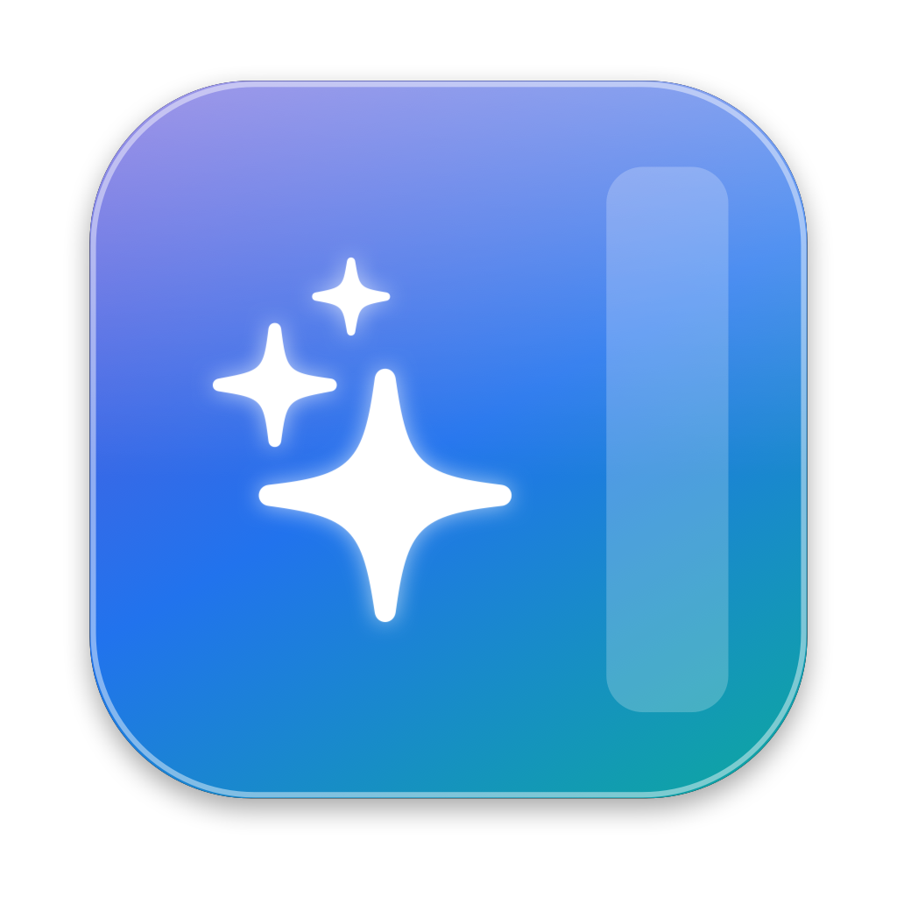
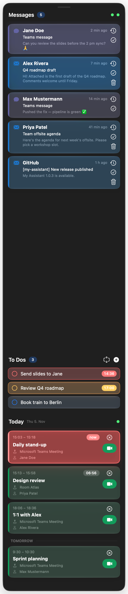
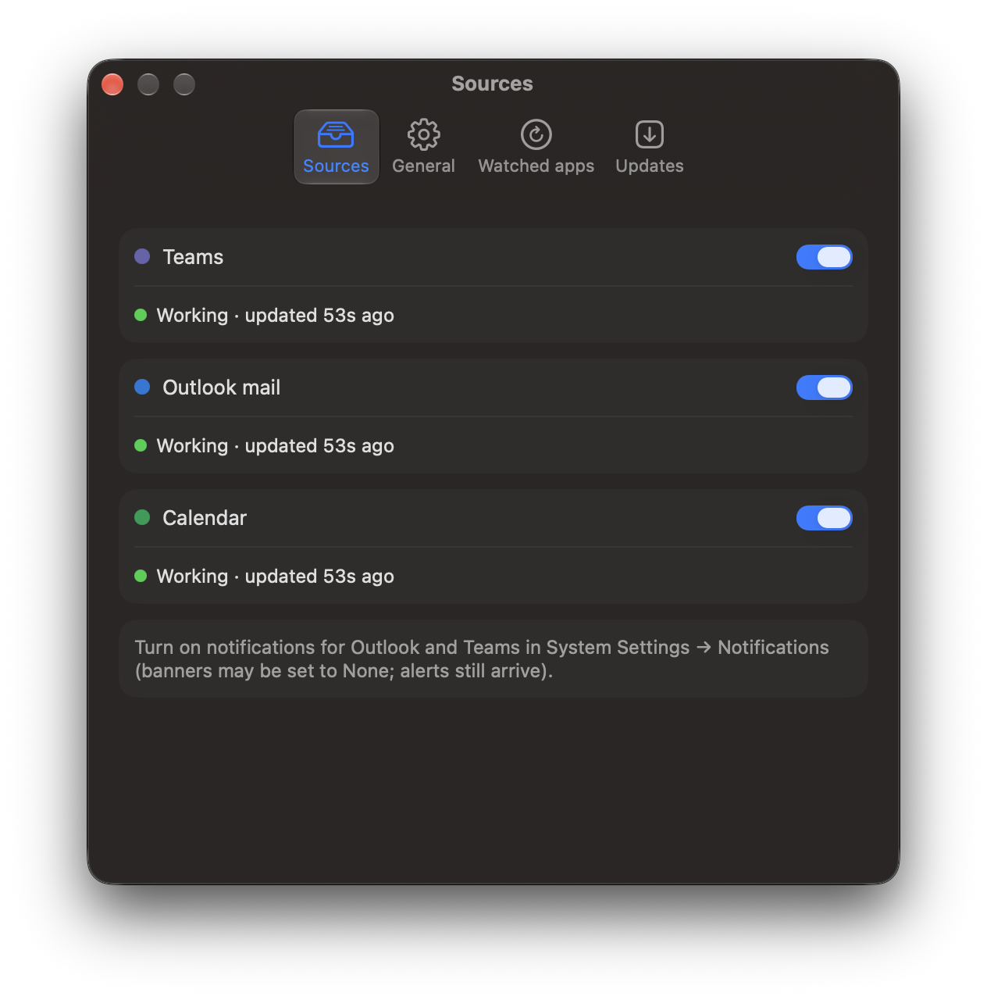
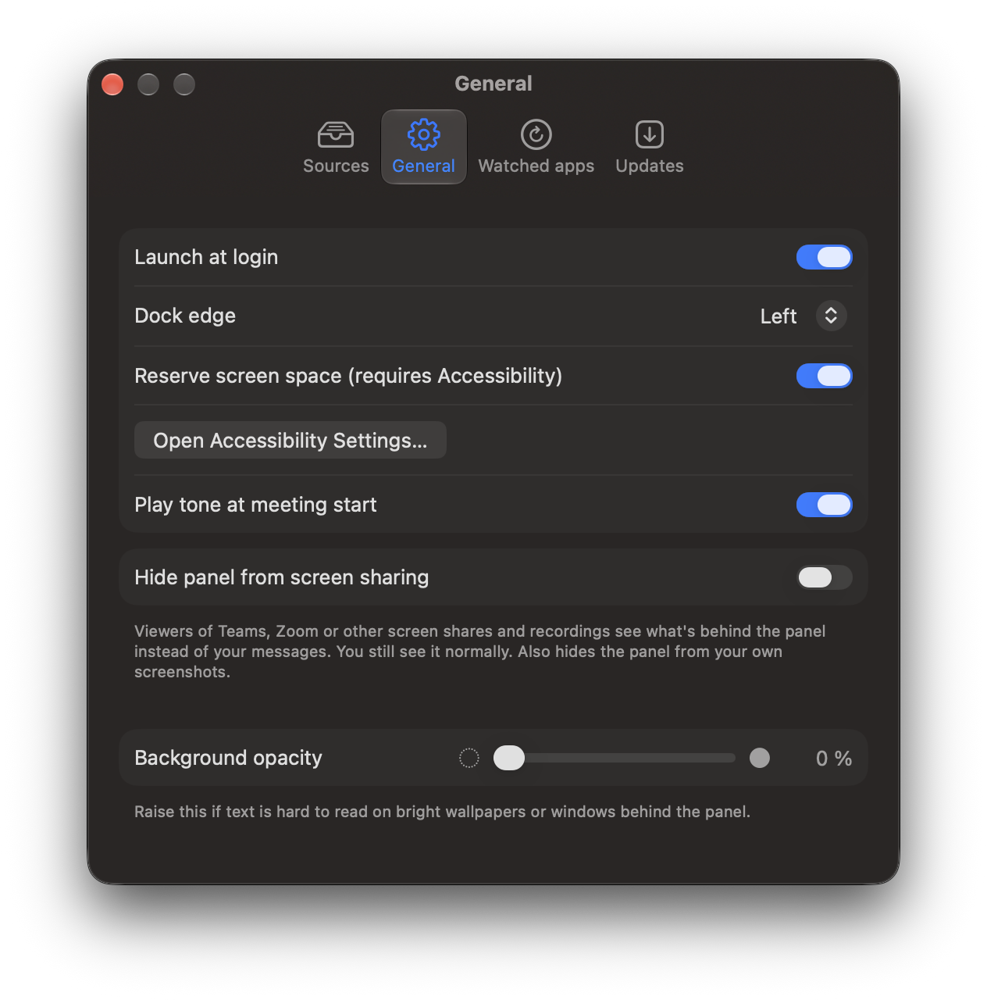
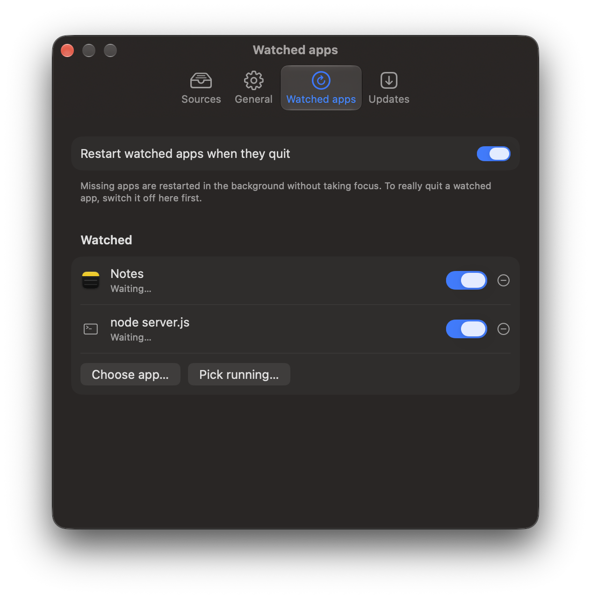
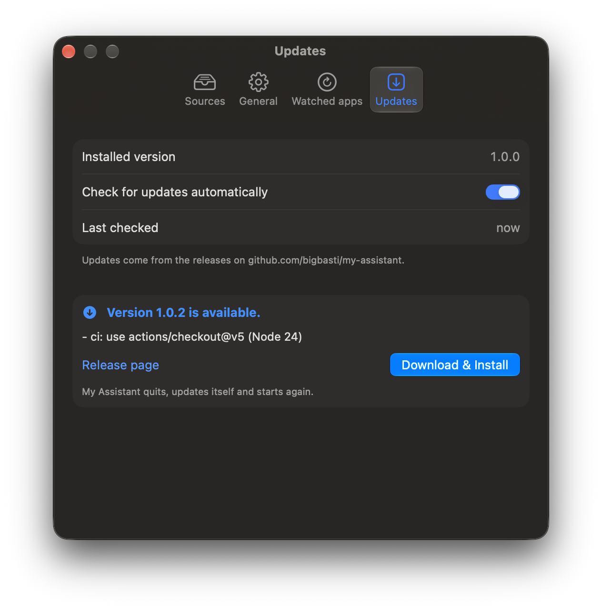

# My Assistant

A docked, always-on-top macOS panel showing Teams chats, Outlook mail, to-dos and today's meetings. Everything is read locally on your Mac; there is no sign-in and no cloud access.

## Screenshots

<table>
  <tr>
    <td rowspan="2" valign="top" width="34%"></td>
    <td valign="top">

**The panel** docks to the left or right edge of a screen and keeps other windows out of its strip.

- **Messages** — new Teams chats (violet) and Outlook mails (blue), newest first, glowing for their first 10 minutes. Click to open the exact chat or mail; ✓ to dismiss, ⟲ to snooze, 🗑 to delete a mail. Right-click for *Create To Do* or *Clear all from …*.
- **To Dos** — one-line tasks with due dates (orange today, red overdue), rich-text notes and reschedule. *Show more* expands the section to half the panel.
- **Today** — the next meetings first; a countdown under 10 minutes, red under 5, pulsing under 1 and a glowing border once started (with a chime). Join opens Teams, Zoom, Webex or Meet. Tomorrow's meetings appear when today is nearly done.

The example data in these screenshots is fictional (`My Assistant --demo`).

</td>
  </tr>
</table>

| Sources | General |
|---|---|
|  |  |
| **Watched apps** | **Updates** |
|  |  |

## Download

Get the latest **My-Assistant-x.y.z.zip** from [Releases](../../releases/latest), unzip it and move **My Assistant.app** to `/Applications`.

The app isn't notarized by Apple, so on first launch right-click it → **Open** → **Open** (or System Settings → Privacy & Security → **Open Anyway**). Requires macOS 26.

Afterwards the app updates itself: **Settings → Updates → Check for Updates → Download & Install** (it also checks once a day). Updates are verified against the release checksum; if an *Apple Development* certificate is in your keychain, the update is re-signed with it so macOS keeps the permissions you granted.

## Releases and versions

Every push to `main` runs [`.github/workflows/release.yml`](.github/workflows/release.yml): it runs the tests, builds the app and publishes a release named after the version `<VERSION>.<run number>` (for example `1.0.17`). To start a new minor or major line, change [`VERSION`](VERSION) (e.g. to `1.1`). Release builds are signed ad hoc; local builds use your own certificate (see below).

The icon is generated by `swift scripts/make-icon.swift`, which writes `Resources/AppIcon.icns` and a 1024 px preview `Resources/AppIcon.png`.

## Build and run

    ./scripts/bundle.sh          # builds build/My Assistant.app
    open "build/My Assistant.app"

Copy the app to `/Applications` before enabling **Launch at login**; registering a login item usually fails for apps run from elsewhere.

## Tests

    swift run MyAssistantTests [--filter Name]

(`swift test` runs nothing with Command Line Tools only.)

## Setup

1. **Full Disk Access** (Teams and Outlook alerts): System Settings → Privacy & Security → Full Disk Access, add `My Assistant.app`. Settings → Sources has a button that opens this pane.
2. **Calendar access** (meetings): allow the prompt, or enable it in Privacy & Security → Calendars. Settings → Sources has a button for this too.
3. **Notifications**: turn on notifications for Teams and Outlook in System Settings → Notifications. Banners may be set to None; alerts still arrive.
4. **Exchange account**: add your work account in System Settings → Internet Accounts with Calendars enabled, so meetings appear in Calendar.

Teams and Outlook alerts are read from the macOS notification database; meetings are read through EventKit.

## Accessibility

"Reserve screen space" moves other apps' windows out of the dock strip. Grant My Assistant access in System Settings → Privacy & Security → Accessibility.

## Rebuild note

`scripts/bundle.sh` signs the app with your first "Apple Development" certificate, so macOS keeps the Accessibility, Full Disk Access, Calendar and Mail automation permissions across rebuilds. Without such a certificate (or with `SIGN_IDENTITY=-`) the app is signed ad hoc; every rebuild then changes its code identity and those permissions must be granted again.
